<div align="center">

<picture>
  <source media="(prefers-color-scheme: dark)" srcset="docs/assets/hero-dark.svg">
  <source media="(prefers-color-scheme: light)" srcset="docs/assets/hero-light.svg">
  
</picture>

# Undercurrent - an unofficial Headlong TypeScript port

**An AI agent that keeps working on your problem after you close the chat, and can message you when it has something.**

<a href="LICENSE"></a>
<a href="package.json"></a>
<a href="tsconfig.json"></a>
<a href="PARITY.md"></a>

[Install](#install) · [Guide](docs/GUIDE.md) · [Parity](PARITY.md) · [CLI](docs/CLI.md) · [Formats](docs/FORMATS.md) · [Changelog](CHANGELOG.md) · [Contributing](CONTRIBUTING.md)

</div>

> [!IMPORTANT]
> Undercurrent was built entirely by AI agents. It aims for best-effort parity with
> [laude-institute/headlong](https://github.com/laude-institute/headlong) and comes with no guarantees. It is not
> affiliated with or endorsed by the Headlong authors or the Laude Institute. Like Headlong, it is alpha research
> software whose agents run shell commands: run it in a sandbox and use a dedicated
> spend-capped API key.

## What it does for you

- **It keeps going without you.** Ask once and close the chat. The agent wakes on its own schedule, works in a
  sandboxed shell, keeps notes, and can send you a message when it has something.
- **It speaks when there is something to say.** Its responder answers a message once, or decides to stay silent.
- **Nothing is hidden.** Every step goes to one append-only trajectory, and its memories are plain files you can read.

## Why this port

- **One runtime.** The engine, CLI tools, installer, Slack and Telegram bridges and web control plane are TypeScript
  on Node 22.18+ (Bun optional), in place of upstream's Bash and Python. Upstream's Rust TUI is vendored as is.
- **Embeddable.** A typed public API in [`src/api.ts`](src/api.ts), with the command and file contracts in
  [docs/CLI.md](docs/CLI.md) and [docs/FORMATS.md](docs/FORMATS.md).
- **Checked against the original.** Differential harnesses run upstream's real tools and the port on the same inputs.
  The `llm` tool matches on 281 of 281 cases (259 byte-identical, 22 documented deviations,
  [report](parity/llm/report.md)). The monolith's assembled model request matches on 75 of 81 checks, with 6
  documented deviations and none unexplained ([report](parity/behavioral/report.md)). Every result and known
  difference is in [PARITY.md](PARITY.md).
- **Tests on real model output.** Tests that need a model reply replay a recorded real response, labelled with its
  model and date. The suite needs no key or network.
- **Any OpenAI-compatible model.** Anthropic, OpenAI, Gemini, OpenRouter, OpenCode/Zen, or a local server such as
  Ollama, llama.cpp, vLLM or LM Studio.

## How it works

<picture>
  <source media="(prefers-color-scheme: dark)" srcset="docs/assets/how-it-works-dark.svg">
  <source media="(prefers-color-scheme: light)" srcset="docs/assets/how-it-works-light.svg">
  
</picture>

This is [Headlong](https://github.com/laude-institute/headlong)'s design: a **dispatcher** drives two **thinkers** over
one trajectory stream. The **responder** handles chat. The **monolith** is the mind: each turn it reads the
trajectory and writes one `bash` block, which runs in a sandbox (Docker when available).

Undercurrent ports that engine at upstream commit `2e39a3f`, with its CLI tools (`traj`, `chat`, `mem`, `skills`,
`recap`, `llm`, `identity`, `thinkers`, …), installer, bridges and web control plane. The macOS app and `deploy/` are
not ported. Command names and `HEADLONG_*` variables are unchanged, so upstream's docs still apply.

## Install

Needs Node 22.18 or newer and pnpm. Docker is optional: it is the default sandbox whenever a daemon answers. There is
no npm package; install from a clone of the repository or a tagged release.

```bash
git clone https://github.com/wolfyy970/undercurrent.git
cd undercurrent
pnpm install
node install.mjs --init   # puts the CLIs on PATH, then walks you through a first identity
```

`--init` asks for a provider key (or `HEADLONG_PROVIDER=local` for a local server), interviews you for the identity's
name and focus, and starts its thinkers and the web dashboard. `node status.mjs` shows what is running;
`node uninstall.mjs` reverses the install. Details: [docs/GUIDE.md](docs/GUIDE.md).

## Use it from TypeScript

The one stable import is [`src/api.ts`](src/api.ts). Run it from a clone; Node strips the types itself.

```ts
import { resolveIdentityEnv, rootTrajFile, deliverMessage } from "./undercurrent/src/api.ts";

const env = resolveIdentityEnv("/path/to/identities/ada");
const traj = rootTrajFile(env.IDENTITY_DIR, env.TRAJ_ID);
deliverMessage(traj, { from: "sam", to: "ada", content: "Can you check the garden log?", originStep: "msg-0001" });
// Written under the engine's lock; delivering the same originStep again is a no-op.
```

The commands an embedding app may run are in [docs/CLI.md](docs/CLI.md), and the on-disk layout in
[docs/FORMATS.md](docs/FORMATS.md). Everything else under `src/` is internal.

## Tests

```bash
pnpm test        # deterministic, no API key or network
pnpm typecheck
```

For release 0.1.0 (2026-10-30) the suite passed 2,422 tests on Linux and 2,406 on macOS, with 0 failures. How to run
the parity harnesses against an upstream checkout: [docs/GUIDE.md](docs/GUIDE.md#tests-and-parity).

## Documentation

| | |
|---|---|
| [docs/GUIDE.md](docs/GUIDE.md) | Requirements, install, local models, web UI, bridges, TUI, known gaps, layout |
| [PARITY.md](PARITY.md) | What is ported, verified, stubbed or deliberately different |
| [SPEC.md](SPEC.md) · [PORTING.md](PORTING.md) | The trace-grounded specification, and how the port was built and tested |
| [docs/CLI.md](docs/CLI.md) · [docs/FORMATS.md](docs/FORMATS.md) | The command and file contracts for embedding |
| [CHANGELOG.md](CHANGELOG.md) | Changes per release |

## Contributing and security

Issues and pull requests are welcome on a best-effort basis; see [CONTRIBUTING.md](CONTRIBUTING.md) and
[CODE_OF_CONDUCT.md](CODE_OF_CONDUCT.md). Report vulnerabilities privately as described in [SECURITY.md](SECURITY.md).

## License and credit

Apache-2.0 (see [LICENSE](LICENSE)). Undercurrent is a port of
[laude-institute/headlong](https://github.com/laude-institute/headlong) (Apache-2.0) by the Headlong authors, with
modifications; see [NOTICE](NOTICE) for attribution and provenance.
